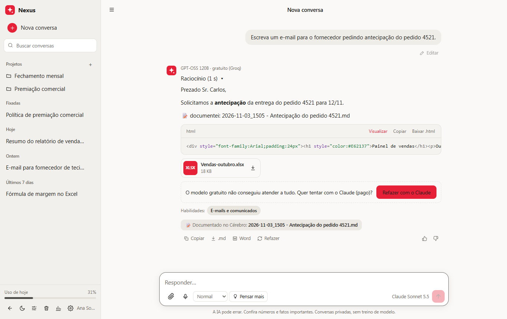
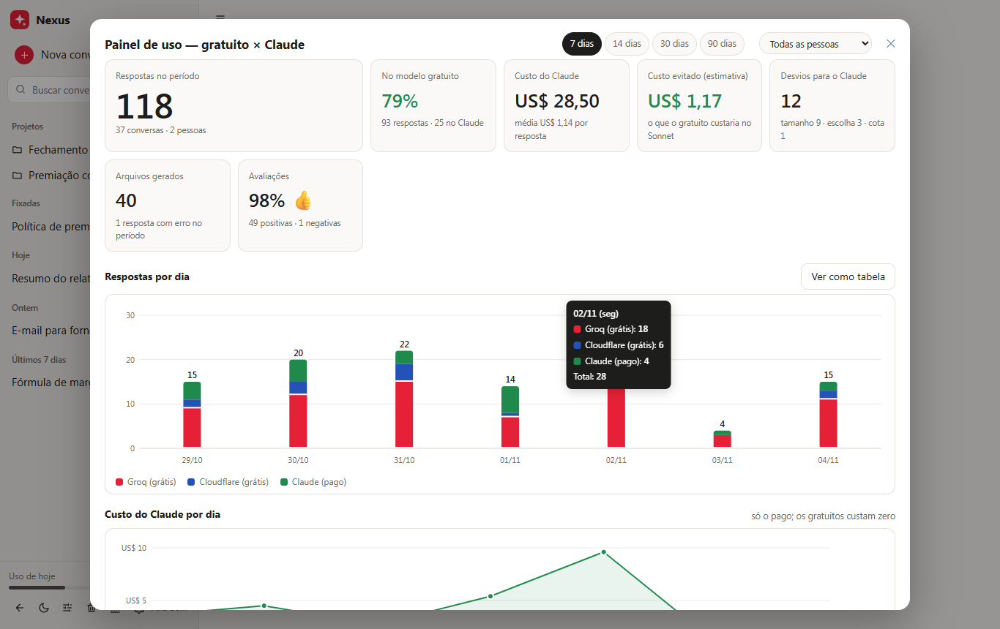
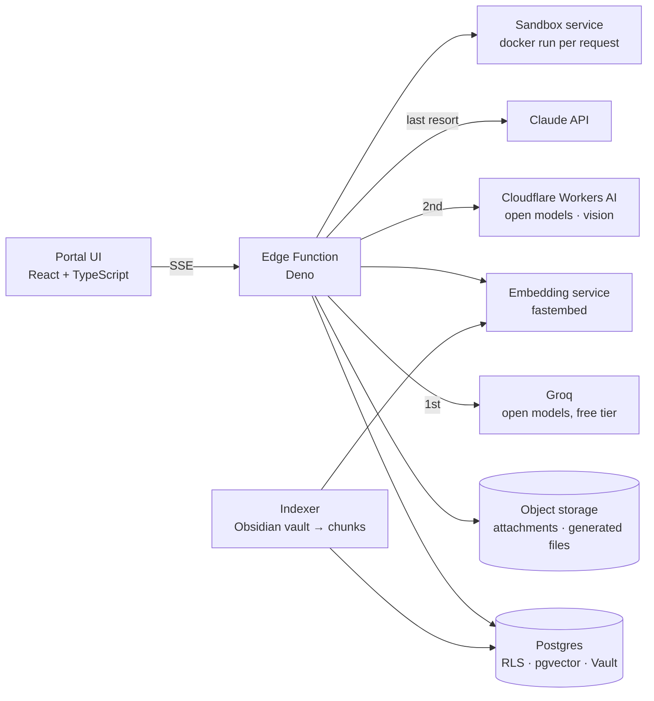
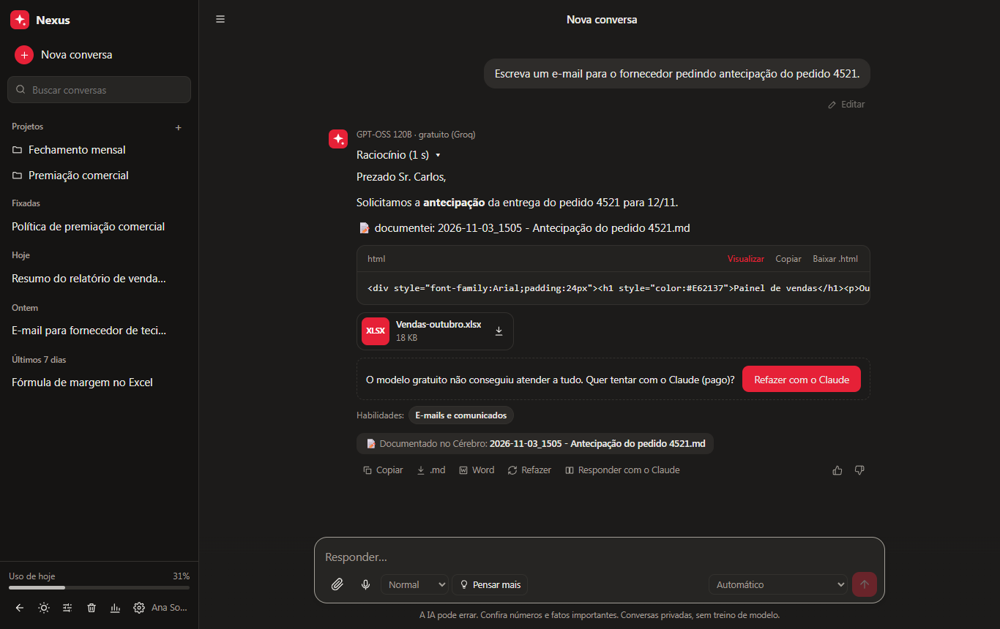
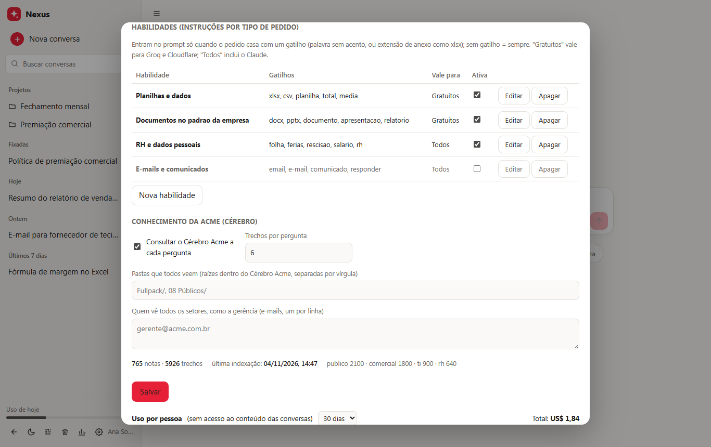
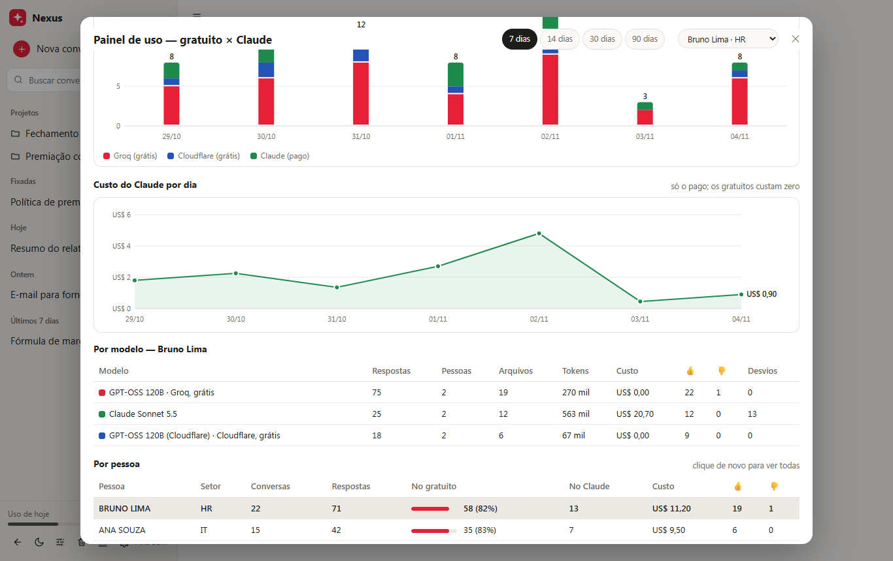
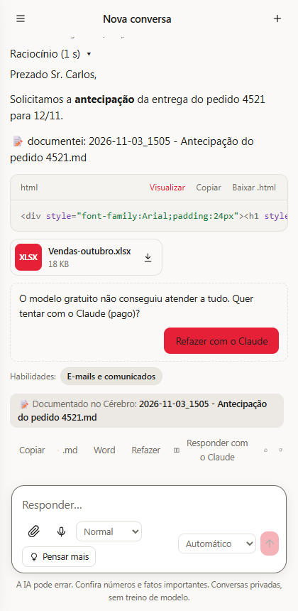

# Nexus — a free-first AI workspace inside a company portal

Nexus is the AI assistant embedded in the internal portal of a mid-size manufacturer.
It was built with one constraint that shaped every decision: **the company would not sign another paid AI plan.**
So the assistant runs as much as it can on free tiers of open models, keeps one paid frontier model strictly as a
last resort, and shows people, on every answer, which model replied and why.

This repository is a curated showcase: architecture, design decisions and a few snippets written from scratch.
It contains no production code, credentials, company data or internal addresses. Screenshots use fictitious data.



## What it does

- **Chat with attachments** (PDF, images, Word, Excel, PowerPoint, text), projects with their own files and
  instructions, personal preferences, voice dictation (Whisper), answer styles.
- **Creates files**: Excel, Word, PowerPoint and charts in the company template, generated inside a disposable
  Python sandbox and attached to the answer for download.
- **Knows the company**: retrieval over the corporate knowledge base (an Obsidian vault with meeting notes,
  reports, decks and per-department documentation), scoped to what each person is allowed to see.
- **Documents itself**: valuable results are written back to the knowledge base, in the person's own folder.
- **Measures itself**: an admin dashboard shows free vs paid answers per day, per person and per model, detours to
  the paid model with the reason, cost, cost avoided, files generated and thumbs up/down.

## Design decisions

### 1. Free first, paid only when there is no other way

Three providers, in order: **Groq** (GPT-OSS 120B and smaller open models, free tier), **Cloudflare Workers AI**
(the same GPT-OSS 120B plus Llama and Qwen, free daily "neurons"), and **Claude** (paid) as the last resort.

Every request is checked against each provider's real limits before it is sent:

| Provider | What is checked | If it does not fit |
|---|---|---|
| Groq | ~8k tokens per minute, 200k tokens per day per model, requests per minute | next model on Groq, then Cloudflare |
| Cloudflare | ~128k context, daily neuron budget minus the estimated cost of this request | Claude |
| Claude | always fits | — |

A request only reaches the paid model for one of five recorded reasons: `size` (does not fit even on Cloudflare),
`image` (a scanned PDF nobody free can read), `quota` (all free quotas exhausted), `error` (every free model
failed) or `manual` (the person chose it). Each reason is stored with the answer and shows up in the dashboard,
so "why are we paying?" always has a precise answer.

Rate limits are handled, not feared. A `429` that says "try again in 7s" is waited out once or twice on the same
model; anything longer marks that model as exhausted until the time the provider gave, and the request moves on.
Conversation state (including tools already executed) travels with the request, so switching models mid-answer is
invisible to the person.

### 2. Big attachments do not need a big context window

The naive approach (dump the whole spreadsheet into the prompt) is exactly what pushes requests to the paid model.
Instead, the free model gets a **preview** of each attachment (the cap shrinks in steps until the prompt fits:
unlimited → 15k → 5k → 1.8k characters) and a note telling it that the complete file is mounted inside the code
sandbox. For spreadsheets this is strictly better than text: the model reads the real file with pandas, computes
exact totals and returns a new workbook. A 240 KB CSV with 6,000 rows is summed to the cent at zero cost.

### 3. Vision on the free tier

Groq's free tier has no vision model. Cloudflare's does (Llama 4 Scout). Images are transcribed and described once,
the text is cached next to the file, and the text-only models receive it as an attachment. ~20 neurons per image.

### 4. A disposable sandbox instead of a hosted code interpreter

One container per request: no network, read-only root, memory and CPU caps, a non-root user and a hard timeout.
Attachments are mounted in, outputs are collected out and uploaded to object storage. A small helper library gives
the model one-call functions for Word, Excel, PowerPoint and charts in the corporate template, so the open model
does not have to know python-docx or openpyxl well to produce a presentable file.

### 5. Retrieval that respects who is asking

Notes are chunked and embedded with a multilingual MiniLM model served locally; search is hybrid (vector + Portuguese
full-text with title weighting, fused with reciprocal rank fusion). Scope is derived from the folder structure:
public, per department, per person. The retrieved passages are stored **inside the user message** so the
conversation stays stable across turns and providers (and cacheable on the paid one).

### 6. Skills that cost nothing when they do not apply

Admins maintain short instruction blocks with triggers (keywords without accents, or attachment extensions such as
`xlsx`). Only the skills that match the current request are injected, which matters when the budget is 8k tokens a
minute. The answer shows which skills were applied.

### 7. Let the free model ask for help

The open model is told to finish with a fixed marker when it could not fully do what was asked (no internet, a file it
could not read, a tool that failed). The server strips the marker, stores a clean answer and emits an event; the UI
shows a one-line suggestion with a **"Redo with the paid model"** button. The person decides. The marker never
reaches the saved text or the knowledge base.



## Architecture



Everything that holds a secret lives in the database vault or environment files; the edge function reads keys
through security-definer functions. Quotas are reconstructed from the stored answers (tokens per provider and model
per day), so there is no separate counter to drift.

## Snippets (written for this README, not copied from production)

### Choosing the provider order with budgets

```ts
type Model = { provider: 'groq' | 'cloudflare'; id: string }

function candidates(opts: {
  preferred: string; groq: Model[]; cloudflare: Model[]
  blocked: Set<string>; groqTokensToday: Record<string, number>
  neuronsToday: number; neuronsForThisRequest: number
}): Model[] {
  const key = (m: Model) => `${m.provider}|${m.id}`
  const groq = opts.groq.filter((m) => !opts.blocked.has(key(m)) && (opts.groqTokensToday[m.id] ?? 0) < 188_000)
  const cf = opts.neuronsToday + opts.neuronsForThisRequest < 9_700
    ? opts.cloudflare.filter((m) => !opts.blocked.has(key(m))) : []
  const first = (list: Model[], id: string) => { const i = list.findIndex((m) => m.id === id); if (i > 0) list.unshift(...list.splice(i, 1)); return list }
  first(groq, opts.preferred)
  const preferredOnGroq = groq[0]?.id === opts.preferred ? [groq[0]] : []
  // same big model on the second provider before the smaller models of the first one
  return [...preferredOnGroq, ...cf.slice(0, 1), ...(preferredOnGroq.length ? groq.slice(1) : groq), ...cf.slice(1)]
}
```

### Waiting out a per-minute limit, giving up on a per-day one

```ts
const secondsIn = (msg: string) => {
  const m = msg.match(/try again in (?:(\d+)h)?(?:(\d+)m)?(\d+(?:\.\d+)?)s/i)
  return m ? Number(m[1] ?? 0) * 3600 + Number(m[2] ?? 0) * 60 + Number(m[3]) : 0
}

async function handle429(msg: string, waits: number, markExhausted: (until: Date) => Promise<void>): Promise<'retry' | 'next'> {
  const s = secondsIn(msg)
  if (s > 0 && s <= 30 && /per minute|TPM|RPM/i.test(msg) && waits < 2) {
    await new Promise((ok) => setTimeout(ok, (s + 0.7) * 1000))
    return 'retry'
  }
  const until = s ? s : /per day|daily|neuron|quota/i.test(msg) ? secondsUntilMidnightUTC() : 60
  await markExhausted(new Date(Date.now() + Math.min(until, 86_400) * 1000))
  return 'next'
}
```

### Shrinking attachment previews until the prompt fits

```ts
const PREVIEW_CAPS = [Infinity, 15_000, 5_000, 1_800]

function fit(messages: Msg[], budgetTokens: number, render: (m: Msg[], cap: number) => string[]): string[] | null {
  for (const cap of PREVIEW_CAPS) {
    const texts = render(messages, cap)              // each attachment cut to `cap` chars + "full file is in /work/input"
    const tokens = texts.reduce((n, t) => n + Math.ceil(t.length / 3), 0)
    if (tokens <= budgetTokens) return texts
  }
  return null                                         // does not fit even as previews → next provider / paid model
}
```

### A marker the model can use to ask for the paid model

```ts
const MARK = /\[SUGGEST_PAID\]/i

function finish(raw: string, emit: (e: unknown) => void) {
  if (MARK.test(raw)) emit({ t: 'suggestion', v: 'paid' })   // UI shows "Redo with the paid model"
  return raw.replace(/[ \t]*\[SUGGEST_PAID\][ \t]*/gi, '').replace(/\n{3,}/g, '\n\n').trim()
}
```

## Stack

React 18 · TypeScript · Vite · Supabase (Postgres, RLS, pgvector, Vault, Edge Functions on Deno) · Groq API ·
Cloudflare Workers AI · Anthropic API · Python 3.12 sandbox (Docker) with pandas, openpyxl, python-docx,
python-pptx, matplotlib, pdfplumber · fastembed (multilingual MiniLM) · Whisper (Groq).

## Status

In production since November 2026 for the HR department first, measured weekly through the dashboard before
opening to other departments. First week on the free-first routing: every spreadsheet, image and e-mail request
answered at zero cost; the paid model was reached only by explicit choice.

Author: Guilherme Sacilotto — IT & Intelligence.

## More screens

All screenshots come from the real UI served locally against a fake API; company, people and numbers are fictitious.

| | |
|---|---|
|  |  |
|  |  |
